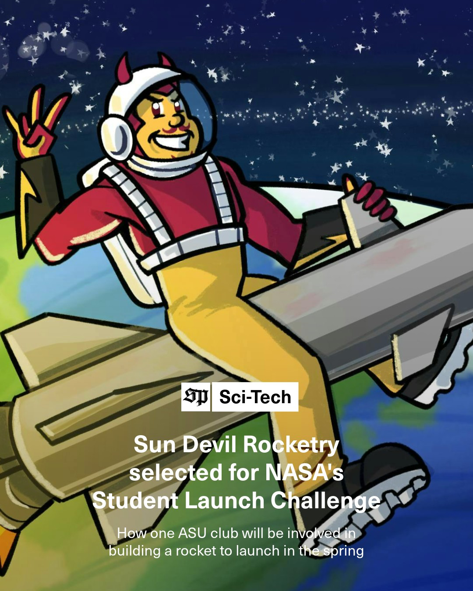

**AHPR Team Lead:** Avi Savalia

Our Advanced High-Power Rocketry team (AHPR) is the team responsible for SDR's most ambitious rocketry projects. Historically, the missions AHPR has undertaken have been self-selected to be whatever the team felt would be the best experience that year. The team brings together SDR's best rocket builders to do cool stuff.

Image: A past AHPR rocket

This year, AHPR decided to undertake a new challenge: the [NASA Student Launch Initiative](https://www.nasa.gov/learning-resources/nasa-student-launch/). This is the first year that ASU has sent a team to the competition, and it's easily the team's most ambitious undertaking. In addition to needing to design a rocket for the challenge, they are also bringing a payload capable of autonomously locating an object and determining the distance to that object after landing.

Read more about us in this [State Press article](https://www.statepress.com/article/2026/10/asu-club-nasa-selection)!
